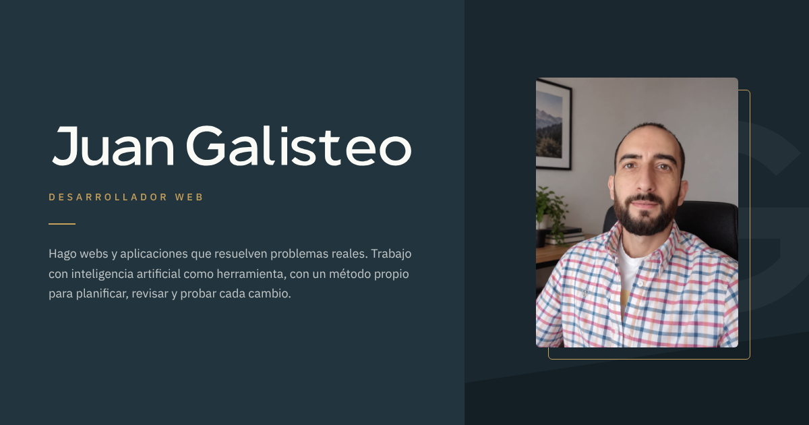

<p align="center">
  
</p>

# Juan Galisteo · Desarrollador web

Mi portfolio personal: **[juangalisteo.github.io](https://juangalisteo.github.io/)**

Desarrollador web titulado en DAW. Hago webs y aplicaciones que resuelven problemas reales, y trabajo con inteligencia artificial (Claude y ChatGPT con Codex) con un método propio para planificar, revisar y probar cada cambio.

## Proyectos

| Proyecto | Qué es |
|---|---|
| **AI Visual Composer** | Producción de vídeo con IA local: de un tema a un vídeo con guion, imágenes, voz y subtítulos. En desarrollo. |
| **[VideoFetch](https://github.com/juangalisteo/videofetch)** | Descargador de vídeos para Windows, con subtítulos creados con IA. |
| **[StreamFetch](https://github.com/juangalisteo/streamfetch)** | Descargador de vídeos en streaming (.m3u8): clases, cursos y webinars. |
| **[Project Manager](https://github.com/juangalisteo/projectmanager)** | Crea en un clic la carpeta de un proyecto listo para trabajar con IA. |

## Cómo está hecha esta web

- **HTML, CSS y JavaScript**, sin librerías ni paso de compilación.
- Identidad visual propia: monograma JG, firma dibujada, tipografía **IBM Plex Sans** y paleta tinta, blanco roto y dorado.
- Adaptada a móvil, accesible con teclado y respetuosa con el movimiento reducido.
- Preparada para buscadores: descripción, datos estructurados de persona, `sitemap.xml` e imagen para compartir en redes.
- Se publica sola en **GitHub Pages** desde la rama `main` cada vez que se sube un cambio. No hace falta compilar nada.

```
index.html          La web
404.html            Página de error
assets/css/         Estilos
assets/js/          Interacción: portada, esquema de AIVC, metodología, filtro de tecnologías
assets/fonts/       IBM Plex Sans (licencia SIL OFL 1.1) y TeX Gyre Chorus (licencia GUST)
assets/img/         Fotos, capturas, favicon e imagen para redes
```

Para verla en tu equipo, abre una terminal en esta carpeta y ejecuta `python -m http.server`. Después entra en `http://localhost:8000`.

## Contacto

- Correo: [juangalisteodev@gmail.com](mailto:juangalisteodev@gmail.com)
- LinkedIn: [linkedin.com/in/juangalisteo](https://www.linkedin.com/in/juangalisteo/)
- GitHub: [@juangalisteo](https://github.com/juangalisteo)

---

© 2026 Juan Galisteo. Logotipos de tecnologías: Simple Icons (CC0), vía React Icons 5.6.0; cada marca pertenece a su dueño. Logo de Gmail: Simple Icons (CC0). Icono de LinkedIn: Font Awesome Free 5.15.4 (CC BY 4.0).
